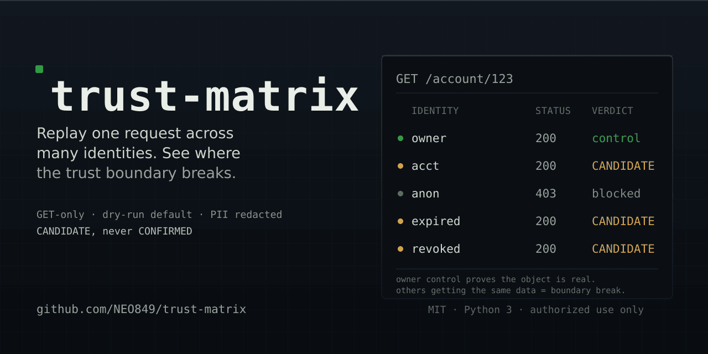
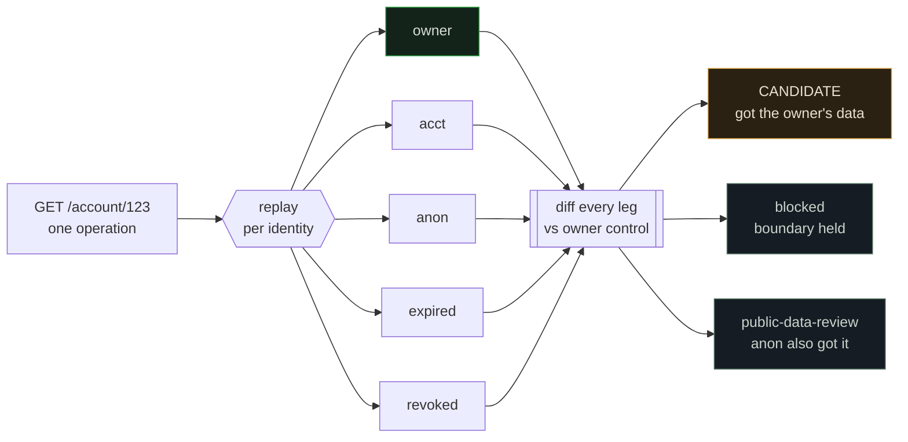

<div align="center">



<br/>

**Replay one request across many identities — see where the trust boundary breaks.**

<em>A focused CLI for authorization (BOLA / IDOR) testing that produces <b>triage-safe evidence</b>,<br/>
not noisy "CONFIRMED!" claims. One GET operation, an identity matrix, an honest verdict.</em>

<br/>

<sub>For bug-bounty hunters, pentesters and API-security engineers — on their own or in-scope systems.</sub>

<br/>

[](https://github.com/NEO849/trust-matrix/actions/workflows/ci.yml)
&nbsp;

&nbsp;

&nbsp;

&nbsp;


<br/>

<a href="#demo">Quick demo</a> · <a href="#why">Why</a> · <a href="#what">What it does</a> · <a href="#different">Why it's different</a> · <a href="#notwhat">What it is NOT</a> · <a href="#install">Install</a> · <a href="#quickstart">Quickstart</a> · <a href="#verdicts">How it decides</a> · <a href="#safety">Safety</a>

</div>

> **Scope / lawful use.** Authorized testing only: your own systems, or in-scope bug-bounty / pentest
> targets. You supply sessions for accounts you control; trust-matrix never creates accounts (AUP),
> only sends GET, and defaults to dry-run. See [`SAFETY.md`](SAFETY.md).

---

<a id="demo"></a>


See the whole idea in one command — **no real target, no credentials, nothing leaves your machine.**
`demo.py` starts a local fixture API with a planted BOLA bug and runs trust-matrix against it:

```bash
git clone https://github.com/NEO849/trust-matrix && cd trust-matrix
python3 demo.py
```

<p align="center">
  
</p>

<details>
<summary>text output</summary>

```text
[demo] fixture API with a planted BOLA bug is live on http://127.0.0.1:42419
[demo] running: trust_matrix.py --go --report md

== Trust-Matrix :: GET /account/123 ==
LABEL              KIND     STATUS SCHEMA  VALUES  PII-LEAK  VERDICT
--------------------------------------------------------------------
TenantA            acct     200    100%    100%    4         CANDIDATE
anon               anon     403    0%      0%      0         blocked
TenantB-expired    expired  200    100%    100%    4         CANDIDATE  <- expired token still honored — broken token expiry enforcement

2 CANDIDATE — reproduce independently and verify server-side before reporting. No auto-submit.
```

</details>

You get the cross-identity matrix, an honest verdict, and a PII-redacted
`trust_matrix_report.md` you can open — in about a minute, against a safe local fixture.

---

<a id="why"></a>


Broken Object Level Authorization (BOLA) is [OWASP API Security #1](https://owasp.org/API-Security/editions/2023/en/0xa1-broken-object-level-authorization/).
You find it by replaying the same request as different users and comparing responses — and by hand
that is exactly where mistakes creep in:

- You need several real accounts and have to juggle their sessions by hand.
- A `200 OK` is easy to misread: the data might just be **public**, not cross-tenant — a false
  positive that burns your credibility the moment a triager spots it.
- The easy-to-forget dimensions — an **expired** token, or one you **revoked** that still works —
  usually go untested.

trust-matrix does the mechanical part once, carefully, and hands you evidence you can trust.

---

<a id="what"></a>




Give it one operation and an identity matrix. It replays the request once per identity and diffs
every leg against the **owner control**:

```
== Trust-Matrix :: GET /v1/account/123 ==
LABEL              KIND     STATUS SCHEMA  VALUES  PII-LEAK  VERDICT
--------------------------------------------------------------------
anon               anon     403    0%      0%      0         blocked
TenantA            acct     200    100%    100%    4         CANDIDATE
TenantB-expired    expired  200    100%    100%    4         CANDIDATE  <- expired token still honored — broken token expiry enforcement
TenantB-revoked    revoked  200    100%    100%    4         CANDIDATE  <- server-issued token still honored after revocation/logout — broken session invalidation

3 CANDIDATE — reproduce independently and verify server-side before reporting. No auto-submit.
```

The **owner** leg is the control: the owner fetching its *own* object must return `200`. That proves
the object is real and owned — so *candidate + control* is automatic before/after evidence. Add
`--report md` and you get a submittable, PII-redacted Markdown write-up out of the box (cold-witness
pair, cross-identity matrix, leaked-PII paths, reproduction steps).

---

<a id="different"></a>


Plenty of tools replay requests across accounts — Burp's Autorize / AuthMatrix (GUI extensions),
and a handful of younger CLIs. trust-matrix is **not** trying to beat them at discovery. Its edge is
**evidence discipline** and the **revocation dimension**:

| | trust-matrix | Typical BOLA tools |
|---|---|---|
| Verdict wording | **CANDIDATE** only — you confirm | often a hard "Confirmed" / "Critical" |
| PII in output | actively **redacted** (length + SHA-1) | frequently raw body / headers |
| Public-data false positive | auto-downgraded to `public-data-review` | varies |
| Revoked-token leg | **yes** — issue → revoke/logout → replay | essentially none |
| Interface | CLI — scriptable, CI-friendly | often GUI / Burp extension |

Being honest about the edge: the **"CANDIDATE, never CONFIRMED" wording** and **active PII
redaction** are, at the time of writing, near-universal gaps in comparable open tools. The
**public-data auto-downgrade** is a *quality* feature, not a unique one — a couple of tools do it
too; it is here because it kills the single most common authorization false positive. The one thing
no comparable tool tests is a **genuinely revoked** server-issued token replayed back at the API.

---

<a id="notwhat"></a>


- **Not a discovery tool.** You tell it which object and which identities. It will not crawl your
  app or guess IDs.
- **Not a scanner.** One operation per run, by design. Sharp, not broad.
- **Not an exploit or auto-submitter.** GET-only, dry-run by default, and it never decides a bug is
  real — that is your job.

---

<a id="install"></a>


```bash
git clone https://github.com/NEO849/trust-matrix
cd trust-matrix
pip install -r requirements.txt   # one dependency: requests
```

Python 3.10+. No build step, no services.

---

<a id="quickstart"></a>


**1. Describe your identities** (copy [`identities.conf.sample`](identities.conf.sample)) —
`label | kind | auth | cookie`, one per line:

```
TenantB          | owner   | Bearer <OWNER_TOKEN>    |
TenantA          | acct    | Bearer <OTHER_TOKEN>    |
anon             | anon    |                         |
TenantB-revoked  | revoked | Bearer <REVOKED_TOKEN>  |
```

**2. Dry-run first** — prints the plan, sends nothing:

```bash
python3 trust_matrix.py --identities identities.conf \
  --base https://api.target.com/v1 --path /account/123
```

**3. Go live** (read-only GETs) and emit a submittable report:

```bash
python3 trust_matrix.py --identities identities.conf \
  --base https://api.target.com/v1 --path /account/123 --go --report md
```

Outputs land in `trust_matrix_out/`: a PII-redacted `trust_matrix_findings.json` and, with
`--report md`, a `trust_matrix_report.md` you can adapt into a disclosure.

<details>
<summary><b>Identity kinds</b> — the five legs you can define</summary>

<br/>

| kind | meaning |
|---|---|
| `owner` | the control — fetches its **own** object, must return 200 (exactly one required) |
| `acct` | a second, separate account (the attacker identity) |
| `anon` | no credentials — if this leg also gets the data, it is **public** → auto-downgrade |
| `expired` | a token whose lifetime has passed (tests expiry enforcement) |
| `revoked` | a token you revoked / logged out server-side (tests session invalidation) |

</details>

---

<a id="verdicts"></a>


| verdict | meaning |
|---|---|
| **blocked** | leg got a non-200 or only an error object — the boundary held |
| **CANDIDATE** | leg got 200 + the owner's data (value overlap > 60% or a leaked PII value) — worth confirming |
| **accessible-review** | leg got 200 but *its own* data, not the owner's — not cross-tenant |
| **public-data-review** | the anon leg also got the data → likely public (working as intended) |
| **invalid-no-control** | the owner leg failed, so no claim can be made — fix it and re-run |

The strongest label is `CANDIDATE`. Server-side confirmation and the decision to report are always
yours.

---

<a id="safety"></a>


The guardrails are built in, not optional: **GET-only**, **dry-run by default**, **no account
creation**, **PII never in clear text** (length + short hash), **no "CONFIRMED" verdict**, **no
auto-submit**. Full threat model and responsibilities in [`SAFETY.md`](SAFETY.md).

---


<details>
<summary><b>Files &amp; how to run the tests</b></summary>

<br/>

```
trust_matrix.py   CLI + replay + verdict logic + Markdown report
diff_core.py      pure JSON diff primitives (schema / value overlap / PII) — offline-testable
demo.py           zero-setup demo — local fixture API + a live run against it
tests/            21 tests — unit (fixtures) + end-to-end against a local fixture server
identities.conf.sample   the input format, documented
SAFETY.md         guardrails as a threat model
```

Run the tests yourself:

```bash
pip install -r requirements.txt pytest
python -m pytest -q      # 21 passed
```

</details>

---

<div align="center">

**Built by [NEO849](https://github.com/NEO849).** Issues and PRs welcome — see [`CONTRIBUTING.md`](CONTRIBUTING.md).


&nbsp;


MIT — see [`LICENSE`](LICENSE).

</div>
